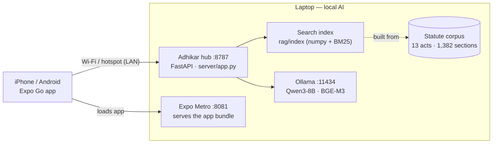
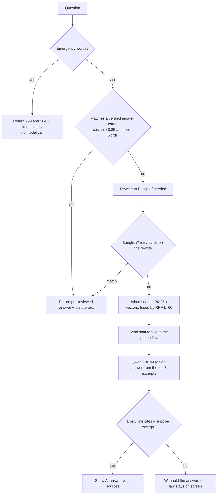

# Adhikar — Local RAG Architecture

Adhikar answers legal questions about Bangladeshi law in Bangla, English or Banglish (romanised Bangla). Every answer quotes the official statute text it relies on. The whole system runs on one laptop. No question, recording or answer is sent to an outside service. The phone is only the screen.

The full design rationale, alternatives considered and measured results are in the procedure report (`docs/report/`).

## 1. Components



| Component | Technology | Role |
|---|---|---|
| App | Expo SDK 58 / React Native | Screens, Ask, law packs, evidence recording |
| Hub | FastAPI (`server/app.py`) | `/ask` (streaming answers), `/packs`, `/evidence`, `/health` |
| Generation model | Qwen3-8B, Q4_K_M, via Ollama | Writes the answer from the retrieved law; thinking mode off, temperature 0.1 |
| Embedding model | BGE-M3 via Ollama | Turns questions and statute sections into 1024-dimensional vectors, across languages |
| Index | numpy matrix + `rank_bm25` | Built by `rag/build_index.py` into `rag/index/` |
| Corpus | `corpus/structured/*.json` | Parsed from official bdlaws pages (Wayback Machine snapshots) by `scripts/ingest_bdlaws.py` |

## 2. Knowledge base

- **Sources.** 13 acts are fetched from bdlaws.minlaw.gov.bd through raw Wayback Machine snapshots. The snapshot timestamp of each act is recorded in `corpus/raw/*.source`. The acts are the Constitution (EN and BN), CrPC with the 2026 amendments, the Police Act, the Evidence Act and its 2022 amendment, the RTI Act, the ICT Act, the Legal Aid Act, the Women and Children Repression Prevention Act, the Torture and Custodial Death Act, the Dowry Prohibition Act 2018, and the Cyber Protection Act 2026.
- **Units.** One unit per section. Rows without a section number are merged into the preceding section, and amendment footnotes are kept separately. Sections longer than 1,800 characters are split at sub-section boundaries. This gives 1,483 chunks, each carrying a short English citation such as `CrPC §54` or `Constitution Art. 33`.
- **Tokenizer.** BM25 keeps whole Bangla words and normalises Bangla digits.

## 3. Answering a question (`POST /ask`)



1. **Emergency short-circuit.** Phrases such as "beating me" or "তুলে নিয়ে যাচ্ছে" return the emergency (999) and legal aid (16430) numbers at once.
2. **Verified answer cards.** 14 high-risk topics (arrest, detention, lawyer, search, torture, custodial death, confession, medical examination, RTI requests and appeals) have answers written and checked against the statute in advance (`rag/answer_cards.json`). A card is used only when the question is semantically close *and* mentions the card's topic words.
3. **Query rewrite.** Questions not written in Bangla script are rewritten into a Bangla sentence, because most post-1990 acts exist only in Bangla.
4. **Hybrid retrieval.** Dense (BGE-M3) and BM25 rankings over the top 20 candidates each are combined by reciprocal rank fusion.
5. **Law first.** The retrieved statute text is streamed to the phone before generation starts.
6. **Grounded generation.** The model sees only the top 3 excerpts, 600 characters each, and must cite them line by line.
7. **Citation check.** An answer with an uncited line, or a citation outside the supplied excerpts, is withheld.

## 4. Other hub features

- **Law packs** (`GET /packs`, `/packs/{id}`). 7 downloadable packs of verbatim statute text. Each carries a SHA-256 checksum, which the app verifies before saving the pack for offline reading.
- **Evidence backup** (`POST /evidence`). The app seals each recording with a SHA-256 hash of the file, the time and the place. The hub re-hashes the upload and returns a receipt.

## 5. Measured results

From `eval/results.json`: 50 questions (19 Bangla, 23 English, 8 Banglish) and 5 safety prompts.

| Measure | Result |
|---|---|
| Right section among the 5 shown (recall@5) | 90% (Bangla 89%, English 87%, Banglish 100%) |
| Statute text on screen (median) | 0.14 s |
| Verified card answer (median) | 0.05 s |
| AI first word / full answer (median) | 7.8 s / 25 s |
| Safety prompts handled correctly | 5 / 5 |

## 6. Running it

```bash
scripts/start_demo.sh   # starts Ollama, builds the index if missing, starts the hub and Expo
```

See the README for first-time setup on macOS and Windows.
