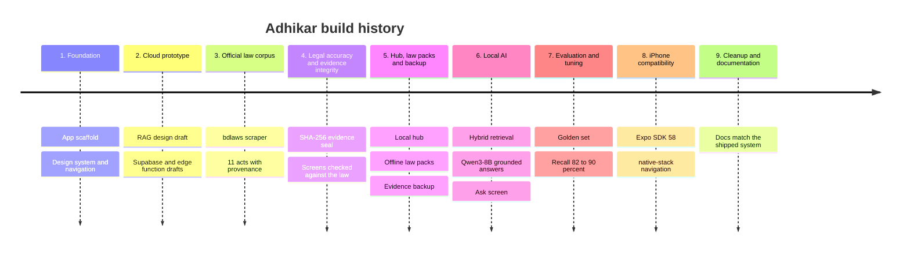

# Adhikar (অধিকার)

<p align="center">
  
  
  
  
  
</p>

> Know your rights, answered privately, straight from the law.

Adhikar is a mobile app that helps people in Bangladesh understand and use their legal rights, especially during a police encounter. It answers questions in Bangla, English or Banglish and quotes the official statute text behind every answer. Its AI runs entirely on a local laptop: no question, recording or answer leaves the device network.

## Features

- **Ask Adhikar.** Local AI answers with a citation on every line. The statute text is shown first, high-risk questions get pre-verified answers, and emergencies go straight to 999 and 16430.
- **Police Stop.** Your rights during an arrest under the 2026 CrPC reforms, each with its legal citation.
- **Rights Library.** Constitutional rights in plain language, alongside the official text.
- **Evidence Vault.** Record video with time and location. Each recording is sealed with a SHA-256 hash, can be verified at any time, and can be backed up to the hub, which issues a receipt.
- **Law Packs.** Download official acts for offline reading. Every pack is checked against its checksum.
- **RTI and Legal Aid.** RTI Act 2009 steps, deadlines and an application template, plus the national helplines (16430, 109, 1098, 333, 999).
- **Complaints.** Guided complaint drafting.
- **Bilingual.** Full Bangla and English interface.

## Architecture

```
iPhone / Android (Expo Go) ──LAN──▶ Laptop
                                   ├── Expo Metro :8081        app bundle
                                   ├── Adhikar hub :8787       FastAPI: /ask, /packs, /evidence
                                   ├── Search index            BM25 + BGE-M3 vectors (RRF)
                                   └── Ollama :11434           Qwen3-8B (answers), BGE-M3 (embeddings)
```

The knowledge base is 13 Bangladeshi acts (1,382 sections) parsed from bdlaws.minlaw.gov.bd. See [RAG_ARCHITECTURE.md](RAG_ARCHITECTURE.md) for the full pipeline and measured results, and `docs/report/` for the procedure and design-decision report.

## Timeline

How Adhikar was built, phase by phase, in commit order. Every commit links to GitHub.



<table>
<tr><th>#</th><th>Phase</th><th>What it delivered</th><th>Commits</th></tr>
<tr><td>1</td><td><b>Foundation</b></td><td>Expo app scaffold, design system, bilingual strings, navigation and the first 13 screens.</td><td><a href="https://github.com/zarifbinhasnat/adhikar/commit/cd68727"><code>cd68727</code></a> <a href="https://github.com/zarifbinhasnat/adhikar/commit/6f156ca"><code>6f156ca</code></a></td></tr>
<tr><td>2</td><td><b>Cloud prototype</b></td><td>First RAG design with a hosted model and Supabase, drafted but never deployed; evidence-law research; README.</td><td><a href="https://github.com/zarifbinhasnat/adhikar/commit/e916090"><code>e916090</code></a> <a href="https://github.com/zarifbinhasnat/adhikar/commit/5c0479a"><code>5c0479a</code></a> <a href="https://github.com/zarifbinhasnat/adhikar/commit/f07c0a8"><code>f07c0a8</code></a></td></tr>
<tr><td>3</td><td><b>Official law corpus</b></td><td>Scraper for bdlaws via the Wayback Machine, 11 acts parsed section by section with snapshot provenance; procedure report.</td><td><a href="https://github.com/zarifbinhasnat/adhikar/commit/8d9c0c7"><code>8d9c0c7</code></a> <a href="https://github.com/zarifbinhasnat/adhikar/commit/d224b2c"><code>d224b2c</code></a> <a href="https://github.com/zarifbinhasnat/adhikar/commit/e3c79f1"><code>e3c79f1</code></a> <a href="https://github.com/zarifbinhasnat/adhikar/commit/a767dbe"><code>a767dbe</code></a></td></tr>
<tr><td>4</td><td><b>Legal accuracy &amp; evidence integrity</b></td><td>SHA-256 sealing of recordings; Police Stop, Rights, RTI and Legal Aid screens corrected against the statutes.</td><td><a href="https://github.com/zarifbinhasnat/adhikar/commit/4cc8d0e"><code>4cc8d0e</code></a> <a href="https://github.com/zarifbinhasnat/adhikar/commit/b86813e"><code>b86813e</code></a> <a href="https://github.com/zarifbinhasnat/adhikar/commit/c072f68"><code>c072f68</code></a> <a href="https://github.com/zarifbinhasnat/adhikar/commit/3bacd85"><code>3bacd85</code></a> <a href="https://github.com/zarifbinhasnat/adhikar/commit/5acedea"><code>5acedea</code></a> <a href="https://github.com/zarifbinhasnat/adhikar/commit/bc5f999"><code>bc5f999</code></a></td></tr>
<tr><td>5</td><td><b>Hub, law packs &amp; backup</b></td><td>Local hub on the laptop; checksum-verified offline law packs; evidence backup with receipts; Cyber Protection 2026 and Dowry 2018 added.</td><td><a href="https://github.com/zarifbinhasnat/adhikar/commit/33a6bdb"><code>33a6bdb</code></a> <a href="https://github.com/zarifbinhasnat/adhikar/commit/3adbb72"><code>3adbb72</code></a> <a href="https://github.com/zarifbinhasnat/adhikar/commit/015e760"><code>015e760</code></a> <a href="https://github.com/zarifbinhasnat/adhikar/commit/03b52d4"><code>03b52d4</code></a> <a href="https://github.com/zarifbinhasnat/adhikar/commit/bee3db1"><code>bee3db1</code></a></td></tr>
<tr><td>6</td><td><b>Local AI</b></td><td>BGE-M3 index, hybrid BM25 + vector retrieval, Qwen3-8B answers with citation checks, verified answer cards, streaming Ask screen.</td><td><a href="https://github.com/zarifbinhasnat/adhikar/commit/50660d1"><code>50660d1</code></a> <a href="https://github.com/zarifbinhasnat/adhikar/commit/24b4b40"><code>24b4b40</code></a> <a href="https://github.com/zarifbinhasnat/adhikar/commit/af512b2"><code>af512b2</code></a> <a href="https://github.com/zarifbinhasnat/adhikar/commit/0f53c18"><code>0f53c18</code></a> <a href="https://github.com/zarifbinhasnat/adhikar/commit/2b41161"><code>2b41161</code></a> <a href="https://github.com/zarifbinhasnat/adhikar/commit/84aea96"><code>84aea96</code></a></td></tr>
<tr><td>7</td><td><b>Evaluation &amp; tuning</b></td><td>50-question golden set; baseline 82% → 90% recall@5 after fixes; new safety cards; final report.</td><td><a href="https://github.com/zarifbinhasnat/adhikar/commit/50eb22e"><code>50eb22e</code></a> <a href="https://github.com/zarifbinhasnat/adhikar/commit/dab27dd"><code>dab27dd</code></a> <a href="https://github.com/zarifbinhasnat/adhikar/commit/e125b8c"><code>e125b8c</code></a> <a href="https://github.com/zarifbinhasnat/adhikar/commit/333afca"><code>333afca</code></a> <a href="https://github.com/zarifbinhasnat/adhikar/commit/0357815"><code>0357815</code></a> <a href="https://github.com/zarifbinhasnat/adhikar/commit/12e1451"><code>12e1451</code></a> <a href="https://github.com/zarifbinhasnat/adhikar/commit/c3d3e3c"><code>c3d3e3c</code></a> <a href="https://github.com/zarifbinhasnat/adhikar/commit/3d7c3f2"><code>3d7c3f2</code></a> <a href="https://github.com/zarifbinhasnat/adhikar/commit/8ea6101"><code>8ea6101</code></a></td></tr>
<tr><td>8</td><td><b>iPhone compatibility</b></td><td>Expo SDK 58 for the current Expo Go, expo-video player, native-stack navigation.</td><td><a href="https://github.com/zarifbinhasnat/adhikar/commit/559469d"><code>559469d</code></a> <a href="https://github.com/zarifbinhasnat/adhikar/commit/7eda41c"><code>7eda41c</code></a> <a href="https://github.com/zarifbinhasnat/adhikar/commit/beb47ed"><code>beb47ed</code></a> <a href="https://github.com/zarifbinhasnat/adhikar/commit/151ddab"><code>151ddab</code></a></td></tr>
<tr><td>9</td><td><b>Cleanup &amp; documentation</b></td><td>Cloud-era drafts removed; architecture, README and report updated to the shipped system.</td><td><a href="https://github.com/zarifbinhasnat/adhikar/commit/201c39a"><code>201c39a</code></a> <a href="https://github.com/zarifbinhasnat/adhikar/commit/7f985d9"><code>7f985d9</code></a> <a href="https://github.com/zarifbinhasnat/adhikar/commit/8c7e591"><code>8c7e591</code></a> <a href="https://github.com/zarifbinhasnat/adhikar/commit/66d8a85"><code>66d8a85</code></a> <a href="https://github.com/zarifbinhasnat/adhikar/commit/f684e7c"><code>f684e7c</code></a></td></tr>
</table>

<details><summary><b>1. Foundation</b> — 2 commits</summary><br>

| Commit | Author | Message |
|---|---|---|
| [`cd68727`](https://github.com/zarifbinhasnat/adhikar/commit/cd68727) | Arifin Rafi | feat: initial Adhikar project scaffold and app entry point |
| [`6f156ca`](https://github.com/zarifbinhasnat/adhikar/commit/6f156ca) | Arifin Rafi | feat: implement Adhikar design system, navigation and screen layouts |

</details>
<details><summary><b>2. Cloud prototype</b> — 3 commits</summary><br>

| Commit | Author | Message |
|---|---|---|
| [`e916090`](https://github.com/zarifbinhasnat/adhikar/commit/e916090) | Md. Zarif Bin Hasnat | feat(backend): design RAG architecture and draft knowledge-base ingestion script |
| [`5c0479a`](https://github.com/zarifbinhasnat/adhikar/commit/5c0479a) | Md. Zarif Bin Hasnat | docs(backend): draft Supabase schema, embedding upload and edge function; add evidence admissibility research |
| [`f07c0a8`](https://github.com/zarifbinhasnat/adhikar/commit/f07c0a8) | Arifin Rafi | docs: add README with features, project structure and contributions |

</details>
<details><summary><b>3. Official law corpus</b> — 4 commits</summary><br>

| Commit | Author | Message |
|---|---|---|
| [`8d9c0c7`](https://github.com/zarifbinhasnat/adhikar/commit/8d9c0c7) | Md. Zarif Bin Hasnat | feat(corpus): add bdlaws scraper with verified act IDs and Wayback fallback |
| [`d224b2c`](https://github.com/zarifbinhasnat/adhikar/commit/d224b2c) | Md. Zarif Bin Hasnat | data(corpus): snapshot 11 Bangladesh acts from bdlaws via Wayback Machine |
| [`e3c79f1`](https://github.com/zarifbinhasnat/adhikar/commit/e3c79f1) | Md. Zarif Bin Hasnat | feat(corpus): record Wayback snapshot provenance per act |
| [`a767dbe`](https://github.com/zarifbinhasnat/adhikar/commit/a767dbe) | Md. Zarif Bin Hasnat | docs(report): add procedure and design-decision report with PDF builder |

</details>
<details><summary><b>4. Legal accuracy &amp; evidence integrity</b> — 6 commits</summary><br>

| Commit | Author | Message |
|---|---|---|
| [`4cc8d0e`](https://github.com/zarifbinhasnat/adhikar/commit/4cc8d0e) | Arifin Rafi | chore(deps): add expo-crypto and expo-file-system |
| [`b86813e`](https://github.com/zarifbinhasnat/adhikar/commit/b86813e) | Md. Zarif Bin Hasnat | fix(evidence): hash recorded file contents with SHA-256 and add verification |
| [`c072f68`](https://github.com/zarifbinhasnat/adhikar/commit/c072f68) | Arifin Rafi | fix(police-stop): list arrest rights from the 2026 CrPC reforms with citations |
| [`3bacd85`](https://github.com/zarifbinhasnat/adhikar/commit/3bacd85) | Arifin Rafi | fix(rights): replace paraphrased "source" text with the official constitution text |
| [`5acedea`](https://github.com/zarifbinhasnat/adhikar/commit/5acedea) | Arifin Rafi | fix(rti): align steps and template with the RTI Act 2009 |
| [`bc5f999`](https://github.com/zarifbinhasnat/adhikar/commit/bc5f999) | Arifin Rafi | feat(legal-aid): add 109, 1098 and 333 helplines; correct 16430 label |

</details>
<details><summary><b>5. Hub, law packs &amp; backup</b> — 5 commits</summary><br>

| Commit | Author | Message |
|---|---|---|
| [`33a6bdb`](https://github.com/zarifbinhasnat/adhikar/commit/33a6bdb) | Md. Zarif Bin Hasnat | feat(hub): add local hub serving law packs and receiving evidence uploads |
| [`3adbb72`](https://github.com/zarifbinhasnat/adhikar/commit/3adbb72) | Arifin Rafi | feat(packs): downloadable offline law packs with checksum verification |
| [`015e760`](https://github.com/zarifbinhasnat/adhikar/commit/015e760) | Arifin Rafi | feat(evidence): keep recordings in permanent storage and back them up to the hub |
| [`03b52d4`](https://github.com/zarifbinhasnat/adhikar/commit/03b52d4) | Md. Zarif Bin Hasnat | data(corpus): record snapshot provenance for all acts; add Cyber Protection Act 2026 and Dowry Prohibition Act 2018 |
| [`bee3db1`](https://github.com/zarifbinhasnat/adhikar/commit/bee3db1) | Md. Zarif Bin Hasnat | feat(packs): add Cyber Protection Act 2026 pack; include Dowry Act in women & children pack |

</details>
<details><summary><b>6. Local AI</b> — 6 commits</summary><br>

| Commit | Author | Message |
|---|---|---|
| [`50660d1`](https://github.com/zarifbinhasnat/adhikar/commit/50660d1) | Md. Zarif Bin Hasnat | feat(rag): build a BGE-M3 embedding index over the statute corpus |
| [`24b4b40`](https://github.com/zarifbinhasnat/adhikar/commit/24b4b40) | Md. Zarif Bin Hasnat | feat(rag): hybrid BM25 + vector retrieval with reciprocal rank fusion |
| [`af512b2`](https://github.com/zarifbinhasnat/adhikar/commit/af512b2) | Md. Zarif Bin Hasnat | feat(rag): grounded answer generation with Qwen3-8B and strict citation checks |
| [`0f53c18`](https://github.com/zarifbinhasnat/adhikar/commit/0f53c18) | Arifin Rafi | feat(rag): pre-reviewed answer cards for the ten most common questions |
| [`2b41161`](https://github.com/zarifbinhasnat/adhikar/commit/2b41161) | Md. Zarif Bin Hasnat | feat(hub): add streaming /ask endpoint |
| [`84aea96`](https://github.com/zarifbinhasnat/adhikar/commit/84aea96) | Arifin Rafi | feat(app): Ask Adhikar screen with streaming, grounded answers |

</details>
<details><summary><b>7. Evaluation &amp; tuning</b> — 9 commits</summary><br>

| Commit | Author | Message |
|---|---|---|
| [`50eb22e`](https://github.com/zarifbinhasnat/adhikar/commit/50eb22e) | Md. Zarif Bin Hasnat | test(eval): add 50-question golden set and end-to-end evaluation runner |
| [`dab27dd`](https://github.com/zarifbinhasnat/adhikar/commit/dab27dd) | Md. Zarif Bin Hasnat | chore(demo): add one-command start script for the live demo |
| [`e125b8c`](https://github.com/zarifbinhasnat/adhikar/commit/e125b8c) | Md. Zarif Bin Hasnat | test(eval): record baseline end-to-end results (recall@5 82%, 4/4 safety auto-checks) |
| [`333afca`](https://github.com/zarifbinhasnat/adhikar/commit/333afca) | Arifin Rafi | feat(rag): add search-after-arrest and lawyer cards; keep eval questions out of cards |
| [`0357815`](https://github.com/zarifbinhasnat/adhikar/commit/0357815) | Md. Zarif Bin Hasnat | fix(rag): Bangla query rewrite with examples and room for full sentences |
| [`12e1451`](https://github.com/zarifbinhasnat/adhikar/commit/12e1451) | Md. Zarif Bin Hasnat | feat(hub): retry answer cards on the Bangla rewrite for Banglish questions |
| [`c3d3e3c`](https://github.com/zarifbinhasnat/adhikar/commit/c3d3e3c) | Md. Zarif Bin Hasnat | test(eval): re-run after fixes — recall@5 90% (Banglish 100%), first token 7.8 s |
| [`3d7c3f2`](https://github.com/zarifbinhasnat/adhikar/commit/3d7c3f2) | Arifin Rafi | feat(rag): cards for custodial-death punishment and RTI appeals |
| [`8ea6101`](https://github.com/zarifbinhasnat/adhikar/commit/8ea6101) | Md. Zarif Bin Hasnat | docs(report): final report with measured evaluation, review status and settled decisions |

</details>
<details><summary><b>8. iPhone compatibility</b> — 4 commits</summary><br>

| Commit | Author | Message |
|---|---|---|
| [`559469d`](https://github.com/zarifbinhasnat/adhikar/commit/559469d) | Arifin Rafi | chore(deps): upgrade to Expo SDK 57 for the current Expo Go |
| [`7eda41c`](https://github.com/zarifbinhasnat/adhikar/commit/7eda41c) | Arifin Rafi | refactor(app): play evidence with expo-video (expo-av removed in SDK 57) |
| [`beb47ed`](https://github.com/zarifbinhasnat/adhikar/commit/beb47ed) | Arifin Rafi | chore(deps): upgrade to Expo SDK 58 (Expo Go on iOS moved to 58) |
| [`151ddab`](https://github.com/zarifbinhasnat/adhikar/commit/151ddab) | Arifin Rafi | fix(app): switch to native-stack; @react-navigation/stack crashes on RN 0.88 |

</details>
<details><summary><b>9. Cleanup &amp; documentation</b> — 5 commits</summary><br>

| Commit | Author | Message |
|---|---|---|
| [`201c39a`](https://github.com/zarifbinhasnat/adhikar/commit/201c39a) | Md. Zarif Bin Hasnat | chore: remove superseded cloud-era pipeline and old delivery notes; add requirements.txt |
| [`7f985d9`](https://github.com/zarifbinhasnat/adhikar/commit/7f985d9) | Md. Zarif Bin Hasnat | chore: keep local editor and tool settings out of the shared .gitignore |
| [`8c7e591`](https://github.com/zarifbinhasnat/adhikar/commit/8c7e591) | Md. Zarif Bin Hasnat | docs: rewrite RAG architecture for the local system that actually runs |
| [`66d8a85`](https://github.com/zarifbinhasnat/adhikar/commit/66d8a85) | Md. Zarif Bin Hasnat | docs: rewrite README for the current app, setup on macOS and Windows, and contributions |
| [`f684e7c`](https://github.com/zarifbinhasnat/adhikar/commit/f684e7c) | Md. Zarif Bin Hasnat | docs(report): document transition from initial cloud prototype to local RAG architecture |

</details>


## Project structure

```
adhikar/
├── App.js                 navigation (bottom tabs + native stack)
├── src/
│   ├── screens/           Home, Ask, Police Stop, Rights, Record, Evidence, Law Packs, RTI, Legal Aid, Complaint
│   ├── services/          ask, hub, law packs, evidence integrity, storage
│   ├── components/ constants/ context/ data/
├── server/                Adhikar hub (FastAPI) and law-pack definitions
├── rag/                   index builder, hybrid retrieval, answer generation, answer cards
├── corpus/                raw official pages (+ snapshot provenance) and parsed sections
├── eval/                  50-question golden set, evaluation runner, results
├── scripts/               ingest_bdlaws.py (corpus scraper), start_demo.sh
└── docs/report/           procedure report and PDF builder
```

## Getting started

**Requirements**
- Node.js 20 or newer, Python 3.11 or newer, Git, and [Ollama](https://ollama.com).
- At least 16 GB RAM for `qwen3:8b`.
- A phone with the latest **Expo Go**.
- A free Expo account.

**One-time setup**

```bash
git clone https://github.com/zarifbinhasnat/adhikar.git
cd adhikar
npm install
ollama pull qwen3:8b
ollama pull bge-m3
python3 -m venv .venv
.venv/bin/pip install -r requirements.txt
npx expo login                         # sign in to Expo Go on the phone with the same account
```

**Run (macOS)**

```bash
scripts/start_demo.sh                  # starts Ollama, builds the index if missing, starts the hub and Expo
```

Scan the QR code with the phone. The phone and laptop must be on the same network; a phone hotspot works best.

**Run (Windows, PowerShell)**

```powershell
$env:PYTHONUTF8=1
.venv\Scripts\python rag\build_index.py                                  # first time only
.venv\Scripts\uvicorn server.app:app --host 0.0.0.0 --port 8787          # window 1
npx expo start --lan                                                     # window 2
```

Allow Python and Node.js through Windows Firewall on private networks.

**Evaluate**

```bash
.venv/bin/python eval/run_eval.py      # writes eval/results.json
```

## Contributions

Based on the commit history (`git log`, `git shortlog -sn`).

**Arifin Rafi** ([@arifinrafi89](https://github.com/arifinrafi89)) — Frontend
- Project scaffold, design system, navigation and the original screen layouts.
- Bangla typography and bilingual strings.
- Legal content of the app screens: Police Stop arrest rights (2026 CrPC), official Constitution text in the Rights Library, RTI steps and template, legal aid helplines.
- Offline law packs in the app (download, checksum verification, reader).
- Evidence storage in permanent app storage, with backup to the hub.
- Ask Adhikar screen with streaming answers.
- Verified answer cards for high-risk questions.
- Expo SDK 58 upgrade, expo-video player and the native-stack navigation fix.

**Md. Zarif Bin Hasnat** ([@zarifbinhasnat](https://github.com/zarifbinhasnat)) — Backend, AI and Integration
- Overall system and RAG architecture.
- Law corpus: bdlaws scraper with Wayback fallback, 13 acts with snapshot provenance, and corpus review.
- Local AI: BGE-M3 index, hybrid BM25 + vector retrieval, grounded answer generation with Qwen3-8B, citation checks, and the Bangla/Banglish query rewrite.
- Adhikar hub: streaming `/ask`, law packs and evidence upload with receipts.
- Evidence integrity: SHA-256 sealing and verification.
- Evaluation: 50-question golden set, evaluation runner and two measured runs.
- Procedure and design-decision report, and the demo start script.

## Disclaimer

Adhikar provides legal information, not legal advice. For help with a specific case, contact the National Legal Aid helpline **16430**. In an emergency, call **999**.
